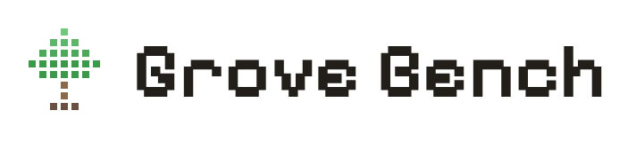

<h1>
  <picture>
    <source media="(prefers-color-scheme: dark)" srcset="docs/brand/grove-lockup-on-dark.png">
    
  </picture>
</h1>

Multi-agent git worktree orchestrator for [Claude Code](https://docs.anthropic.com/en/docs/claude-code). A Windows-native Electron desktop app that manages concurrent AI coding threads, each in an isolated git worktree with a dedicated PTY terminal.

## Features

- **Concurrent threads** — Run multiple Claude Code instances in parallel, one per thread
- **Isolated worktrees** — In a git project, every thread gets its own worktree so agents never conflict. A folder without git works too, with threads editing it in place
- **Integrated terminal** — Built-in xterm.js terminals with full PTY support
- **Thread management** — Start, monitor, and stop threads across projects from a single UI
- **Project memory** — Persistent notes per project, shared across threads

## Tech Stack

Electron · Svelte 5 · Tailwind CSS v4 · TypeScript · node-pty · xterm.js

## Installing

Download `Grove-Bench-Setup-<version>.exe` from [Releases](https://github.com/ParsonsProjects/grove-bench/releases). The installer is not code signed yet, so Windows SmartScreen shows "Windows protected your PC" on first run: choose **More info**, then **Run anyway**. After that, the app checks for new releases and offers the update in the title bar. Some antivirus tools, AVG among them, may also flag a new unsigned release.

## Using Grove Bench

You need either a Claude plan (Pro, Max, Team or Enterprise) with [Claude Code](https://code.claude.com/docs/en/setup) installed and signed in, or an Anthropic API key. Git 2.17 or later is recommended: without it, the agent edits your project folder in place and its edits can't be rewound.

1. **Add a project**: a folder on your computer, ideally a git repository. A folder without git is added as it is.
2. **Start a thread**: tell the agent what to work on. By default it works on a new branch in its own copy of the project (a git worktree), so your checkout is left alone.
3. **Approve its actions**: in the default **Ask** mode the agent checks with you before each edit or command.
4. **Finish**: review the work in the **Changes** tab, commit it, then open a pull request (**Create PR**) or merge the branch yourself.

The in-app help (the **?** in the title bar) covers each step in detail.

## Building from Source

Needs npm 11.19.0 or later (`npm install -g npm@11`). The repo's `.npmrc` only installs package versions that have been public for at least 7 days, only lets the dependencies listed under `allowScripts` in `package.json` run install scripts, and only installs from the npm registry. Older npm would skip those checks, so it refuses to install instead. If an install stops because a new package has an install script, `.npmrc` says how to approve or deny it.

```bash
# Install dependencies
npm install

# Run in development mode
npm start
```

## Scripts

| Command | Description |
|---|---|
| `npm start` | Run in dev mode |
| `npm run dist` | Build the Windows installer into `out/` |
| `npm run typecheck` | Type check the TypeScript and the Svelte components |
| `npm test` | Run all tests |
| `npm run test:watch` | Watch mode |
| `npm run test:coverage` | Run tests with coverage |

## License

[FSL-1.1-MIT](./LICENSE) (Functional Source License). You can use, change and share Grove Bench for any purpose except offering it in a competing commercial product or service. Each release becomes available under the MIT License two years after it comes out.

Code published before this change, including releases up to `v0.0.0-alpha.2`, stays available under the MIT License.
